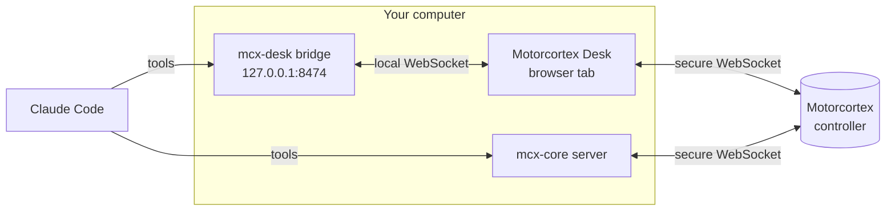

<p align="center">
  
</p>

<h1 align="center">Motorcortex AI tools</h1>

<p align="center">
  <strong>Give your AI assistant a live view into your Motorcortex machine.</strong><br>
  Plot signals, measure step responses and read or write the parameter tree —<br>
  by asking in plain language.
</p>

<p align="center">
  
  
  
  <a href="https://docs.motorcortex.io"></a>
</p>

---

## What you can ask

With Motorcortex Desk open in your browser and connected to a controller:

| You say | What happens |
|---|---|
| *"Plot the actual and target positions of all six joints."* | The traces appear live in your Desk tab, actual-versus-target pairs on the same axis, grouped by unit. |
| *"Plot the tracking error of joint 2."* | Plots the controller's own error signal — or, only if the controller does not publish one, builds it as `actual − target` and tells you so. |
| *"What's the overshoot and settling time of that last step?"* | Measures it from the buffered samples and reports the window it used. |
| *"At what frequency is it ringing? Show me the spectrum."* | Reads the FFT, names the dominant frequency and opens the Spectrum panel. |
| *"Screenshot this and export the last ten seconds as CSV."* | Frames the view, saves a PNG and a CSV, and tells you where they are. |
| *"Find every parameter with temperature in its name."* | Searches the live parameter tree and lists paths, types and current values. |
| *"Set the speed override to 50 %."* | Checks that the parameter can be written, shows you the old and new value, asks before changing a running machine, and reads the result back. |

## Quick start

**1. Have the prerequisites**

| You need | For | Get it |
|---|---|---|
| [Claude Code](https://code.claude.com/docs/en/overview) | everything | the AI assistant these plugins extend |
| Node.js 18 or newer | `mcx-desk` | [nodejs.org](https://nodejs.org) |
| [`uv`](https://docs.astral.sh/uv/) | `mcx-core` | macOS / Linux: `curl -LsSf https://astral.sh/uv/install.sh \| sh` · Windows: `winget install astral-sh.uv` |
| Motorcortex Desk in Chrome, Edge or Firefox | `mcx-desk` | [desk.motorcortex.io](https://desk.motorcortex.io), connected to your controller |

**2. Add the marketplace and install** — in a Claude Code session:

```
/plugin marketplace add vectioneer/motorcortex-ai-tools
/plugin install mcx-desk@motorcortex
```

Installing `mcx-desk` installs `mcx-core` with it. Run `/reload-plugins`, or
restart Claude Code, to load them.

**3. Open Desk and ask.** The Desk tab finds the plugin on its own within a
few seconds. Then ask Claude to plot something.

> [!TIP]
> Only want parameter access, without plotting? Install `mcx-core` on its own:
> `/plugin install mcx-core@motorcortex`, then tell Claude the controller's
> address.

## The plugins

### `mcx-desk` — live plotting in Motorcortex Desk

Drives a Motorcortex Desk tab in your browser: the plot you watch is the plot
Claude works on.

| Skill | Does |
|---|---|
| `desk-plot` | Finds the parameters, adds traces with unit-aware axis placement, sets the update rate and frames the view. Builds custom computed signals only for quantities the controller does not publish. |
| `desk-analyze` | Mean, RMS, min/max, peak-to-peak and quantiles over any window; FFT spectra and the dominant frequency; overshoot, settling time, rise time and the lag between traces. |
| `desk-capture` | PNG screenshots, CSV export of the buffered data, and saving or loading the trace setup. |

### `mcx-core` — Motorcortex knowledge and the parameter tree

Teaches Claude the platform and lets it work with a controller directly.

| Skill | Does |
|---|---|
| `param-explore` | Lists, finds and reads parameters on the connected controller, with their type and size. |
| `param-write` | Writes values — single, bulk or an array slice — after checking each path, confirming risky writes, and reading the result back. |
| `docs-map` | A map of every page on docs.motorcortex.io, so Claude opens the right page instead of guessing. |
| `architecture-overview` | How a Motorcortex system fits together: runtime, parameter tree, communication, client APIs, tools, security. |
| `terminology` | The platform's terms, so what Claude writes uses Motorcortex's words. |

## How it works



Both plugins run small servers on your own computer. `mcx-desk` relays
Claude's requests to the Desk tab you already have open and uses that tab's
connection; `mcx-core` connects to the controller you name.

## Safety and privacy

- **Local only.** The Desk bridge listens on `127.0.0.1` and accepts
  connections only from Motorcortex Desk and from pages on your own computer;
  nothing on your network can reach it. `mcx-core` connects only to the
  controller you configure, over TLS.
- **Writes are checked and confirmed.** A write from the Desk plugin needs
  your explicit approval of the exact path and value — one approval per
  write, also in auto-accept mode. `param-write` refuses outputs and
  mismatched values before anything is sent, asks before mode and state
  commands, logic parameters and any change on a production machine, and
  reads every value back.
- **Files stay in one folder.** Screenshots, CSVs and trace setups are
  read and written only in `~/glplot-hub-files`, and an existing file is
  never replaced without your OK.
- **What gets installed.** `mcx-desk` needs nothing beyond Node.js.
  `mcx-core` downloads `fastmcp` and `motorcortex-python` from PyPI the first
  time it starts.
- **What Claude sees.** Parameter values, plot data and screenshots that
  Claude reads become part of your conversation with Claude, like anything
  else you share with it.

## Troubleshooting

<details>
<summary><strong>Claude says no Desk tab is connected</strong></summary>

Open [Motorcortex Desk](https://desk.motorcortex.io) in Chrome, Edge or
Firefox; the tab connects to the plugin by itself within a few seconds. With
several Claude sessions running, they share one tab — if the Claude badge in
Desk is dimmed, click it to let this session use the tab.

</details>

<details>
<summary><strong>It works in Chrome but not in Safari</strong></summary>

Safari blocks a secure web page from connecting to a server on your own
computer, which is how Desk reaches the plugin. Use Chrome, Edge or Firefox.

</details>

<details>
<summary><strong>Desk or Claude cannot connect to the controller</strong></summary>

Your browser and your computer have to trust the controller's certificate
first. Follow
[Install a browser certificate](https://docs.motorcortex.io/docs/getting-started/connect-your-pc/install-a-browser-certificate/)
on docs.motorcortex.io, or open `https://<controller address>` once and
accept it.

</details>

<details>
<summary><strong>A plugin's tools are missing</strong></summary>

Claude Code shows a message at start-up when a prerequisite is missing:
`mcx-desk` needs Node.js 18 or newer, `mcx-core` needs `uv`. Install it and
restart Claude Code. If a single tool a skill mentions is missing, update the
plugins (below).

</details>

<details>
<summary><strong>Port 8474 is taken, or Desk runs on its own server</strong></summary>

Set `GLPLOT_HUB_MCP_PORT` to another port and open Desk with
`?mcpPort=<port>`. For a Desk page served from your own server, add its
address to `GLPLOT_HUB_ORIGINS`. Set either before starting Claude Code.
Details: [`plugins/mcx-desk/mcp/README.md`](plugins/mcx-desk/mcp/README.md).

</details>

## Updating

```
/plugin marketplace update motorcortex
```

Claude Code then offers the new plugin versions. Each plugin's `CHANGELOG.md`
lists what changed.

## Help and documentation

- **Documentation** — [docs.motorcortex.io](https://docs.motorcortex.io)
- **Questions and support** — [support.motorcortex.io](https://support.motorcortex.io)
- **Motorcortex** — [motorcortex.io](https://motorcortex.io)

## Licence

[MIT](LICENSE) © Vectioneer B.V. The bundled third-party packages keep their
own licences; see
[`plugins/mcx-desk/mcp/THIRD_PARTY_NOTICES.md`](plugins/mcx-desk/mcp/THIRD_PARTY_NOTICES.md).
"motorcortex" is a trademark of Vectioneer.

<sub>This repository is published from Vectioneer's source with every
release; changes made here directly are replaced by the next one.</sub>
